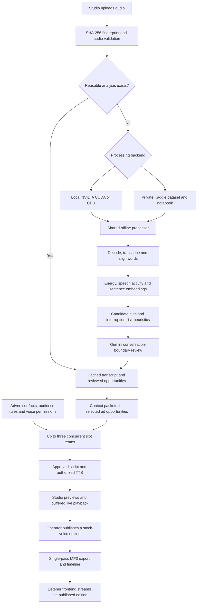
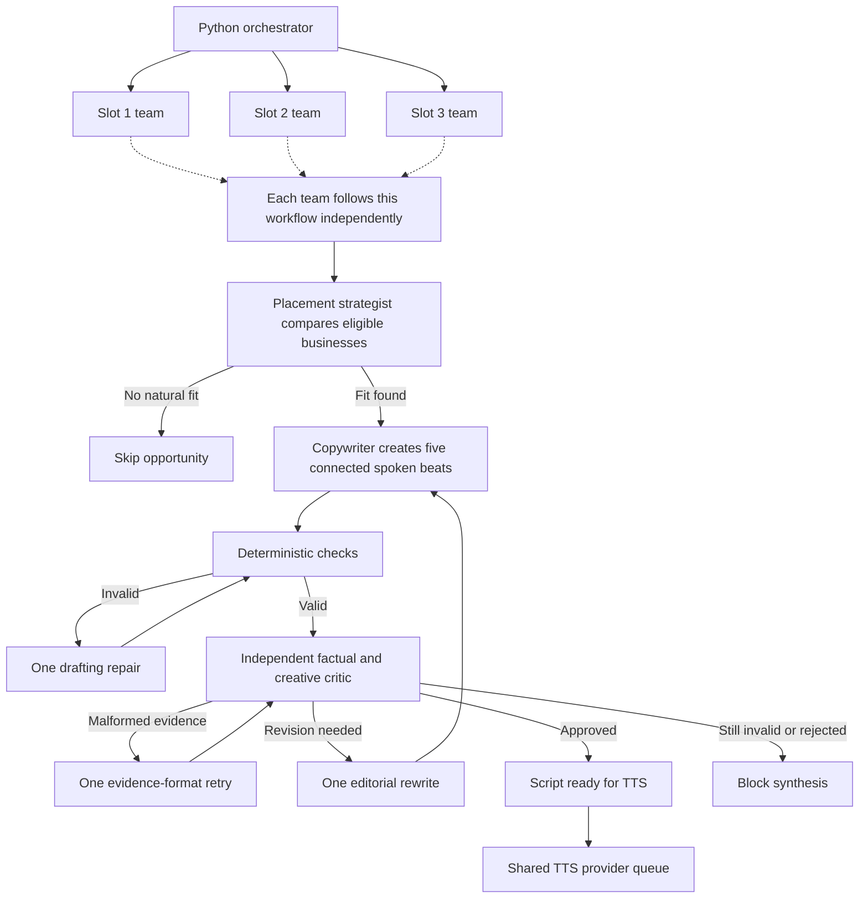

# Resonant: implementation and tradeoffs

Resonant is currently one local Python application plus an optional processing environment and external model APIs. Its agents are independently prompted model calls coordinated by Python, not separate autonomous servers. The listener frontend and Studio share the application but show different interfaces; this is not production role-based authentication.

## End-to-end pipeline

### Offline processing

`pipeline.py` is used by both `local_processor.py` and the generated Kaggle worker. It decodes audio, uses WhisperX transcription and word alignment, computes acoustic energy and Silero speech activity, embeds sentences/context, ranks possible cuts, and emits candidate data and preview/report files. GPU mode accelerates the applicable ASR/alignment work; some processing, including the current embedding stage, remains on CPU. A quiet interval is a candidate signal, not proof of a good editorial interruption.

Local jobs use a separate `.processor-venv` and queue within the application so two episode jobs do not compete for the same GPU. Kaggle jobs upload a private input dataset, submit a notebook, poll and download artifacts. Both feed the same text boundary review. Timings record stages and total elapsed work; Kaggle waiting/transfers are separate from worker compute.

### Context and selection

The strategist receives up to 200 words immediately before a cut, selected earlier relevant passages, eligible advertiser briefs and explicit audience preferences. Profile hates and restrictions veto advertisers before LLM selection. The strategist compares the remaining businesses semantically and can choose no ad.

Earlier passages are selective retrieval, not complete episode-wide understanding or a persistent thematic memory. A relevant gym example can fall outside the immediate window. Broader thread tracking and calibrated sarcasm handling remain areas for improvement. Preliminary keyword category cues still influence which reviewed opportunities enter the live shortlist; the later business comparison is model-based.

## The agent network

The diagram summarizes bounded loops; they are not unbounded recursion. Writer validation has at most two draft attempts per editorial pass. An independent critic can request one editorial rewrite. The critic's own malformed evidence gets one correction attempt against the same unchanged script. Unsupported or unverifiable copy stays blocked. Each concurrent model client owns its prompt/schema so one slot cannot overwrite another slot's instructions.

The writer currently targets 110–140 spoken words, one connected sentence, a grounded callback, a small number of approved facts, and a useful CTA. Five clauses are assembled with pause cues. Length, evidence, inventory and permission checks remain implementation contracts. They do not prove that the copy is compelling or that every claim is true; independent review and operator judgment add separate checks.

## Editable prompts

**[all prompts.py](<all prompts.py>) is the editable source of prompt text.** `all_prompts.py` is only the import adapter for the filename containing a space. Agent implementation files reference the central module.

| Main prompt | Role |
|---|---|
| `BOUNDARY_BATCH_REVIEWER` | Live conversation-boundary review |
| `BUSINESS_STRATEGIST` | Compare businesses and explain the fit |
| `COPYWRITER` | Create the spoken advertisement |
| `INDEPENDENT_CRITIC` | Review claims, callback and copy quality |
| `PERSONA_SIMULATOR` | Optional synthetic-listener experiments, not real audience evidence |

The same file contains TTS/style guides and corrective instructions. Restart after saving edits. Selection/creative cache signatures include prompt configuration; existing published audio is not automatically rewritten. Format schemas, retry limits and explicit product exclusions remain in code.

## Caching and delivery

| Cached layer | Inputs that matter |
|---|---|
| Uploaded episode | Audio-content fingerprint |
| Offline artifacts | Episode and completed processing outputs |
| Boundary review | Review packet and prompt signature |
| Business selection | Context, eligible briefs, preferences and prompt signature |
| Script/session | Episode analysis, selected facts, context, prompt and relevant configuration |
| TTS | Approved spoken text, voice, speed and pronunciation/render settings |
| Custom voice use | Sample identity plus current episode/advertiser grants and revocation state |

Completed analysis is reused when campaigns or profiles change. Explicitly review/reprocess when changing upstream analysis configuration; the app does not universally rerun every upstream stage automatically. Different voice/speed choices can reuse approved copy but need different audio. Decisions unavailable because generation was disabled are not allowed to masquerade as valid no-ad cache hits.

Stock voices use Gnani Timbre v3. Authorized custom voices use Gnani's separate cloning model; local rendering supplies unsupported pause/tempo behavior for that model. References, embeddings and private custom media stay out of the repository. Current custom-voice permission records are operator attestations, not identity verification.

Studio's Web Audio player lazily decodes versioned chunks, buffers ahead and skips an unavailable ad rather than intentionally stalling the podcast. The listener frontend currently streams a published continuous MP3 with byte-range support. Publishing preserves source order, normalizes ads toward local episode loudness, inserts padding and exports once; the prior edition remains available until export succeeds. An already-playing stream retains its current edition. Per-listener server-side dynamic insertion, HLS delivery and a CDN are future work, not claims about the present listener player.

## Files, operations and limits

- `web/`: listener and operator interfaces; backend details stay in Studio.
- `podcast_catalog.py`, `local_job.py`, `kaggle_job.py`: uploads and processing orchestration.
- `contextual_selection.py`, `live_cache.py`: fit, agent execution, audio and caching.
- `voice_library.py`: authorized references and permission-scoped synthesis/media.
- `listener_delivery.py`, `stitch_podcast_ads.py`: approved stock-voice publishing and export.
- `cache/`, `jobs/`: ignored runtime state, media, artifacts and logs; no database or Redis service is required.

This is a localhost prototype. It needs authentication/authorization, durable distributed job recovery, multi-user isolation, resource/spend limits, monitored infrastructure and production media delivery before public operation. Restarts can interrupt local orchestration; recovery of a remotely running Kaggle job is limited. Generated creative quality, earlier-stance recall and model service availability remain imperfect. The host used for clean-install checks has no available NVIDIA GPU, so its tests verify dispatch and error behavior rather than real CUDA inference.
