# Why Resonant exists

Resonant explores a simple question: **what if a podcast ad continued the listener's train of thought instead of resetting it?**

A host describes gaining confidence by adding a little weight at the gym each week. A relevant gym or training service can refer back to that example, explain its actual offering, and give one useful next step. A random commercial at the same timestamp loses that connection. A well-written callback still fails if it interrupts a question, an unfinished explanation, or the emotional payoff of a story.

The engineering problem is therefore both **where an ad belongs** and **what it should say**.

## A real market, with a clearly defined scope

- **$2.862 billion:** U.S. podcast advertising revenue in 2025, up **17.6%** year over year, according to the IAB/PwC full-year report. This is the report's traditional audio-podcast advertising definition, not the entire global podcast economy. [IAB/PwC, April 2026, podcast section](https://www.iab.com/wp-content/uploads/2026/04/IAB_PwC_Internet_Ad_Revenue_Report_Full_Year_2025_April_2026.pdf#page=24).
- **167 million people, or 58% of Americans age 12+:** monthly podcast consumers in The Infinite Dial 2026. This audience measure includes listening **or watching**, unlike the narrower advertising definition above. [Edison Research at SSRS, March 2026](https://ssrs.com/insights/the-infinite-dial-2026/).

These U.S. figures provide an auditable market baseline; they should not be presented as a global total or added together as revenue opportunities. Sources checked November 15, 2026.

## Why an ad that resonates could work better

The hypothesis is that an ad grounded in the current conversation feels more relevant, gives the product a memorable association, and makes the call to action more meaningful. Instead of a generic invitation to visit a website, a planner might ask the listener to choose a weekly layout immediately after a discussion of planning priorities.

Context and associations can provide retrieval cues for memory. That motivates the callback design; it does **not** establish that any particular generated advertisement improves recall. [Nielsen Norman Group's explanation of context, association and memory](https://www.nngroup.com/articles/recognition-and-recall/) provides useful background, rather than a Resonant-specific advertising experiment.

The intended business outcomes are more qualified website visits or clicks, stronger CTA response, and fewer skips. **Resonant has not measured improvements in CTR, conversions, brand recall, or revenue.** A spoken CTA can lead to a later visit or code redemption rather than an immediate click. Those outcomes need separate measurement.

An appropriate experiment would randomly compare ordinary approved copy against contextual callback copy, holding the product, offer, placement, duration and delivery conditions as constant as practical. Track completion/skip rates, attributed visits or redemptions, and delayed recall with an exposure definition and attribution window. Do not substitute an LLM's simulated listener reaction for a real experiment.

## Why the host's voice matters

Host-led advertising can carry a commercial premium. For example, Libsyn's published seller guidance lists a 60-second baked-in host read at **$24–$26 CPM**, versus **$12–$15 CPM** for programmatic inventory. These are one seller's rate ranges, not guaranteed creator payouts or a universal market average. [Libsyn's sponsorship guide, September 2026](https://libsyn.com/blog/podcast-sponsorship/).

With the host's explicit authorization, reusable voice synthesis could let a host approve more campaign variants without recording every revision. A future commercial system could support voice licensing, campaign approval and compensation to the host. That is a way to expand a creator's participation in advertising, rather than assume their voice can be used for free.

Voice identity alone does not recreate a genuine host endorsement. In Spotify's report of a Nielsen study, host reads had stronger emotional connection, while host-read and voice-talent ads had similar recall and purchase-intent outcomes. The study evaluated recorded advertising formats, **not AI-cloned hosts**. [Spotify/Nielsen research](https://ads.spotify.com/en-US/news-and-insights/who-should-voice-your-podcast-ads/).

Current implementation: upload an authorized reference, record the speaker and permission, restrict usage by podcast and advertiser, activate an embedding with Gnani, and revoke future use. These records are local operator attestations, not verified identities or signed licensing contracts. Host voices are never automatically extracted from uploaded podcasts. Public downloadable custom-voice editions are deliberately blocked; permission-scoped live playback is separate.

## Future: respond to an explicitly shared need

A future opt-in integration could receive a small, relevant intent from a user's assistant or another connected app. For example:

> The user tells their assistant: “I'm hungry, I have twenty minutes, and I want a vegetarian option.”

With permission to share that specific intent, Resonant could compare suitable food advertisers, verify the available offer, and generate a natural spoken suggestion with a useful CTA. It would still need an appropriate interruption point. The presence of a need does not make every ad helpful.

This is **a proposed extension**, not a current feature. There is no integration that reads a user's AI chats, infers hunger, or monitors their personal life. A sound design would use explicit opt-in, source-specific sharing controls, short-lived intent, revocation, and minimal data transfer. It should not infer diagnoses or exploit distress. Paid recommendations should be identifiable as advertising rather than presented as independent assistant advice.

```mermaid
flowchart LR
    U[User explicitly shares a current need] --> P[Permission and minimal intent]
    P --> F[Check timing, preferences and suitable inventory]
    F --> V[Verify product facts and available offer]
    V --> W[Write a contextual spoken message]
    W --> R[Review and identify sponsored content]
    R --> T[Authorized voice TTS]
    T --> L[Relevant suggestion with a useful CTA]
```

Other future work includes longer-term thematic memory, better sarcasm/stance handling, real attribution and A/B testing, creator licensing and payments, and scalable playlist/CDN delivery. None should be confused with a completed feature merely because its diagram is plausible.
