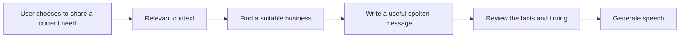

# The idea behind Resonant

This is a hackathon project. We wanted to explore whether podcast ads could feel like a continuation of the conversation.

## Where it started

Podcast ads often arrive while you are following a train of thought. Even when the product is interesting, the transition can feel random. We wondered whether the conversation itself could give an ad a better opening.

One example from our demo was a discussion about confidence, with a story about gradually lifting heavier weights. A gym ad could call back to that progress before introducing the gym. The conversation gives the ad something concrete to connect to.

Our hunch is that a connected message could be easier to remember and give the listener a more relevant reason to act. We have not run a study or measured a click-rate improvement. It is an idea we wanted to build and hear for ourselves.

## What made it interesting to build

- A pause does not automatically mean the speaker has finished their thought.
- Mentioning a product is not the same as liking it; they might be criticizing it or being sarcastic.
- A useful connection might be an earlier example or a broader theme, rather than the latest keyword.
- Fluent copy can still sound like a boring product catalogue.
- An ad can read well on screen and sound awkward in TTS.

Those problems led to the pipeline: analyze the podcast, review possible breaks, compare businesses, write and critique the copy, then synthesize and insert the approved ad.

## A familiar voice

We also wanted to try a host's voice when the host allows it. A reusable voice sample could make different versions easier to produce, without asking the host to record every change. Hosts approving campaigns and earning from authorized voice use would be an interesting extension. Payments and licensing are not built yet.

The current app records voice permissions for specific podcasts and advertisers. It does not automatically take a host's voice from an uploaded podcast.

## What could come next

Imagine a user explicitly tells a connected assistant: “I'm hungry and want a quick vegetarian meal.” If they choose to share that small piece of context, a future version could match a suitable business and speak a relevant suggestion at an appropriate moment.

That integration is an idea, not something this app currently does. Other things we would like to explore are better memory of earlier conversation, more natural copy, real listener feedback, and changing ads without rebuilding the full audio file.

For how the current implementation works, see [ARCHITECTURE.md](ARCHITECTURE.md). For setup, see [README.md](README.md).
