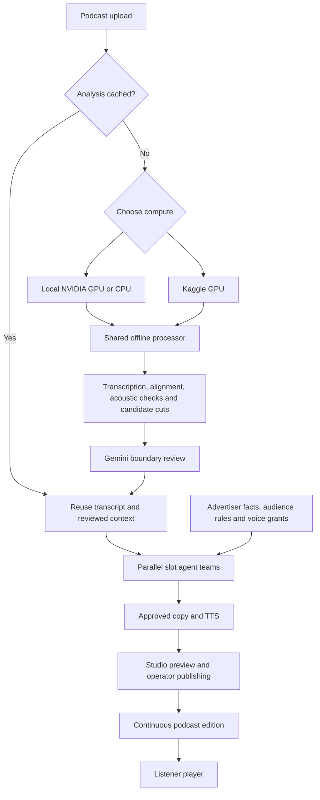
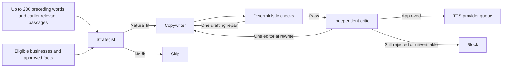

# Resonant

**Ads that pick up the thread of the conversation.**

Resonant is a podcast advertising prototype that finds appropriate breaks, connects an advertisement to what the speakers were talking about, reviews the copy, generates speech, and publishes a continuous listening edition. Operators manage the work in Studio; listeners see podcasts and a player.

## The context: a growing market, an awkward interruption

Podcast advertising is already a substantial business. IAB/PwC reports **$2.862 billion in U.S. podcast ad revenue in 2025**, growing **17.6%** year over year. This is traditional audio-podcast advertising, not the entire global podcast market. Separately, The Infinite Dial 2026 reports **167 million monthly U.S. podcast consumers**, or **58% of Americans age 12+**, including people who listen or watch. [IAB/PwC report, p.24](https://www.iab.com/wp-content/uploads/2026/04/IAB_PwC_Internet_Ad_Revenue_Report_Full_Year_2025_April_2026.pdf#page=24) · [Edison Research at SSRS](https://ssrs.com/insights/the-infinite-dial-2026/).

The opportunity is straightforward: a commercial can reach a valuable audience and still arrive in the wrong place, sound unrelated, or offer an unhelpful next step. Resonant asks whether the ad can continue an idea the listener is already thinking about.

For example, a speaker explains gaining confidence through small improvements in weightlifting. A gym ad can refer back to that progression, introduce its actual facilities or introductory tour, and give a relevant CTA. It should not interrupt an unfinished thought or invent a promise that joining the gym will produce confidence.

## Why resonance matters

The product hypothesis is **better conversational fit → stronger relevance and memory associations → more useful CTA response**. A callback gives the product an association with an idea the listener has just heard. Context and associations can aid memory retrieval, but that general principle does not prove an ad-performance improvement. [Background on context and memory](https://www.nngroup.com/articles/recognition-and-recall/).

We want to improve qualified visits/clicks, code redemptions, recall and completion, not merely generate fluent speech. **This repository does not demonstrate a measured lift in CTR, conversions or recall.** Audio CTAs may lead to a later website visit rather than an immediate click. Controlled experiments and attribution are planned, rather than inferred from model-generated listener reactions.

## The host's voice and the creator's opportunity

Host reads can command a premium: Libsyn's published guidance lists **$24–$26 CPM for a 60-second baked-in host read**, compared with **$12–$15 CPM for programmatic inventory**. Those are seller rate ranges, not guaranteed host earnings. [Libsyn sponsorship guide](https://libsyn.com/blog/podcast-sponsorship/).

With explicit permission, a reusable host voice could make campaign variants practical without requiring a new recording for every revision. The commercial opportunity includes host approval, licensing and compensation; payment and contract systems are future work. A familiar synthetic voice is not evidence that the host personally uses a product or endorses a generated claim. Spotify/Nielsen research found stronger emotional connection for recorded host reads, but similar recall and purchase-intent outcomes across host-read and voice-talent formats; it did not test cloned hosts. [Research and its limits](https://ads.spotify.com/en-US/news-and-insights/who-should-voice-your-podcast-ads/).

Resonant already supports authorized reference uploads, per-podcast/per-advertiser voice permissions and revocation. These are local permission records, not verified identities. No host voice is automatically extracted from an uploaded episode.

## The solution, in simple terms

1. **Understand the episode once:** transcribe, align words and find candidate breaks locally or on Kaggle.
2. **Check the conversation:** reject breaks that interrupt questions, explanations or story payoffs.
3. **Find a business that fits:** compare eligible advertisers using preceding context and retrieved earlier passages.
4. **Write and challenge the ad:** separate strategist, copywriter and critic calls work in bounded teams, with up to three slots running in parallel.
5. **Speak and deliver:** synthesize approved text, preview it in Studio, then publish a continuous listener edition.



## Agent infrastructure

Each slot has its own model calls and prompt state; the agents are coordinated by Python, not deployed as independent servers. A strategist can return no ad. The writer targets 110–140 spoken words with pause cues and a concrete CTA. Deterministic checks and an independent critic can block copy before TTS. Revisions and malformed-evidence retries are bounded.



Edit **[all prompts.py](<all prompts.py>)** to change the agents' instructions. It includes the writing guides and retry prompts; `all_prompts.py` is just its import adapter. Restart after saving. Prompt signatures invalidate relevant new creative/selection decisions, while existing published editions remain unchanged. Schemas, explicit eligibility checks, length gates and retry limits remain code contracts.

**Important nuances:** analysis is cached across campaign changes; local episode processing is queued to avoid competing GPU jobs; three ad-slot workflows can run concurrently; TTS uses a shared provider queue. Earlier context is selective retrieval, not perfect episode-wide thematic memory. Studio has buffered chunk playback, while the current listener app streams a published MP3 rather than doing per-listener server-side live insertion.

See **[ARCHITECTURE.md](ARCHITECTURE.md)** for the detailed pipeline, cache boundaries, voice handling and limitations, and **[PROJECT_CONTEXT.md](PROJECT_CONTEXT.md)** for research context, economics and experimental design.

## Future direction: a relevant response to a current need

With a user's explicit opt-in, a future assistant integration could share a small, short-lived intent such as “I'm hungry, I have twenty minutes, and I'd like a vegetarian option.” Resonant could match an appropriate advertiser, verify the offer, and generate a natural spoken suggestion and useful CTA at a suitable moment.

This is a roadmap idea. The current app does not read AI conversations, monitor someone's life or infer hunger. Such an integration would need minimal data sharing, clear permission and revocation, factual offer verification, and identifiable sponsored content. Longer-term conversation memory, host licensing/payments, real A/B tests, and scalable playlist/CDN delivery are also future work.

## Run it locally

**No Docker or Codex required.** The checkout contains advertiser fixtures, not private audio or credentials. It starts with an empty library.

## Start

Prerequisites: Python **3.11 or 3.12**, Git, FFmpeg and `ffprobe` on PATH. FFmpeg installation examples: `winget install Gyan.FFmpeg` (Windows), `brew install ffmpeg` (macOS), or `sudo apt install ffmpeg` (Debian/Ubuntu). Open a new terminal after changing PATH.

```bash
git clone https://github.com/aimadhav/Resonant.git
cd Resonant
python setup.py
python run.py
```

Use `python3` if that is your Python command. Setup creates `.venv` and copies `.env.example` without overwriting existing settings. Activation is unnecessary. Listener: **http://127.0.0.1:5097/** · Studio: **http://127.0.0.1:5097/studio**. No API keys or Kaggle account are needed just to start, upload and listen.

## Local GPU processing — no Kaggle account

Local acceleration targets **NVIDIA CUDA**. CPU mode is supported, including on Macs; other GPU backends are not implemented. Install compatible drivers and CUDA libraries. The upstream [WhisperX guide](https://github.com/m-bain/whisperX#setup) documents CUDA 12.8; consult [PyTorch installation guidance](https://pytorch.org/get-started/locally/) for your hardware. Versions are pinned to the successful cloud run: WhisperX 3.8.6 and Torch 2.8.0.

```bash
python setup.py --processing --torch-index-url https://download.pytorch.org/whl/cu128
python run.py
```

This creates an isolated `.processor-venv` and prints the device PyTorch detects. In Studio → Episodes → Process this episode, choose **My device**, then **NVIDIA CUDA GPU** or Auto. Explicit CUDA mode fails if CUDA is unavailable rather than silently switching to CPU. First use downloads model weights from the internet.

For CPU:

```bash
python setup.py --processing --torch-index-url https://download.pytorch.org/whl/cpu
```

Choose CPU in Studio; long episodes can be slow. Use Small for lower GPU-memory requirements. `config.json` controls pipeline defaults. An existing compatible worker environment can be selected with `LOCAL_PROCESSOR_PYTHON` in `.env`.

### Standalone offline worker

Windows:

```powershell
.processor-venv\Scripts\python local_processor.py --check --device cuda
.processor-venv\Scripts\python local_processor.py --audio episode.mp3 --out results/my-episode --device cuda --model small
```

Linux/macOS:

```bash
.processor-venv/bin/python local_processor.py --check --device auto
.processor-venv/bin/python local_processor.py --audio episode.mp3 --out results/my-episode --device auto --model small
```

This runs the same decode, transcription, alignment, energy/VAD, embeddings and candidate pipeline used on Kaggle, directly on your device. Outputs include transcript/candidate data, `runtime.json`, `worker_status.json`, `compute_timings.json` and `compute.log`. Optional `--transcript existing-whisperx.json` reuses an aligned transcript. Studio additionally performs Gemini boundary review, ad generation and publishing.

## Ad API keys

Edit `.env`: set `GEMINI_API_KEY` and `GNANI_API_KEY`. Keep `PROCESSING_BACKEND=local` for local processing. Backup keys are optional. Local transcription/acoustic processing does not use these APIs; Gemini text reviews/writing and Gnani speech still require internet and their respective credentials. Never commit `.env`, voice samples, embeddings or private recordings.

## Optional Kaggle cloud

Run `python setup.py --kaggle` to install the optional CLI, set **your own** `KAGGLE_USERNAME` in `.env`, authenticate once, and select Kaggle cloud in Studio. On Windows use `login.ps1`. On Linux/macOS:

```bash
export KAGGLE_CONFIG_DIR="$PWD/.kaggle"
.venv/bin/kaggle auth login
python run.py
```

You need your own Kaggle compute access and quota. Upload, submission, polling and download are automatic. Local mode does not authenticate with or upload to Kaggle.

## Workflow and verification

Upload in Episodes → choose local/Kaggle processing → authorize Gemini transcript review → choose businesses and listener preferences in Campaigns → prepare → publish to listeners. Three slot teams run concurrently. Analysis stays cached across campaign/profile changes. Keep the app running during processing. Remote-running-job recovery remains limited.

```bash
python verify_clone.py
python -m unittest discover -s tests -p "test_*.py"
```

`verify_clone.py` tests empty startup, both frontends, upload and range-streaming using synthetic audio, with no provider calls. GPU routing and failure behavior have unit coverage; real CUDA inference must still be validated on the recipient's hardware because this development host has no available NVIDIA CUDA device.

Runtime data lives in ignored `cache/` and `jobs/` folders. The supplied tests require FFmpeg; some pipeline tests need the processing packages. Custom voices remain permission-scoped; publishing downloadable custom-voice editions is blocked. This is a localhost demo, not an authenticated public service.
