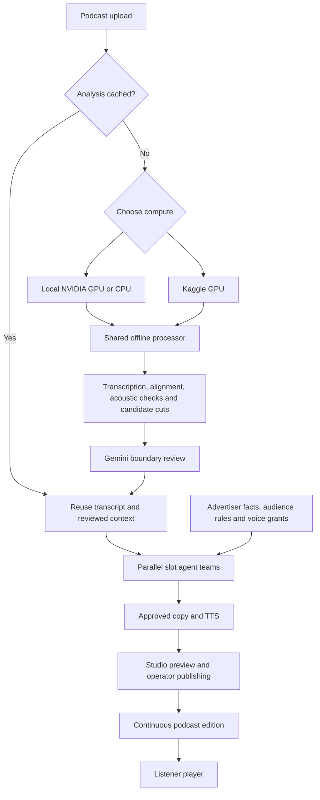
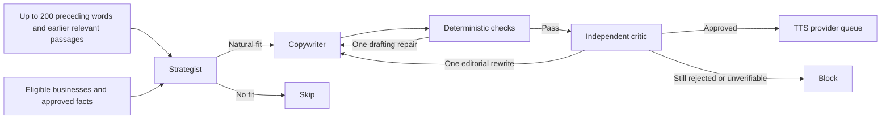

# Resonant

**A hackathon project about making podcast ads fit the conversation.**

## The idea

You are listening to a podcast, getting into a story, and suddenly an unrelated ad cuts in. We wanted to try something different: what if the ad picked up something the speakers had just talked about?

Say the host is talking about confidence and describes adding a little more weight at the gym each week. A gym ad could start by calling back to that example, then introduce the gym and give you a useful next step. It would feel connected to the conversation instead of appearing out of nowhere.

That connection is what we mean by **Resonant**. Our hunch is that connecting an ad to an idea you are already thinking about could make it more memorable and its CTA more relevant. We have not tested whether it gets more clicks—we built the pipeline to explore the idea.

The tricky part is not just writing the ad. It also needs to arrive at a sensible moment, without cutting off a question, an explanation, or the end of a story.

## What we built

Upload a podcast, find possible breaks, let a few agents compare businesses and write an ad, generate the voice, and stitch it into the episode. There is a Studio page for setting things up and a separate listener page that just plays podcasts.

**Most major Indian languages:** the pipeline can be adapted for multilingual podcasts and contextual ads using language-aware transcription, context review and Gnani TTS. Hindi/Hinglish has been tested in a prototype; each additional language needs transcription, placement and pronunciation validation before rollout.

We also explored using a host's voice, with their permission, so they would not need to record every variation themselves. That could eventually become another way for hosts to earn from their voice. For now, the app has voice samples and permission controls; licensing and payments are ideas for later.

## The solution, in simple terms

1. **Understand the episode once:** transcribe, align words and find candidate breaks locally or on Kaggle.
2. **Check the conversation:** reject breaks that interrupt questions, explanations or story payoffs.
3. **Find a business that fits:** compare eligible advertisers using preceding context and retrieved earlier passages.
4. **Write and challenge the ad:** separate strategist, copywriter and critic calls work in bounded teams, with up to three slots running in parallel.
5. **Speak and deliver:** synthesize approved text, preview it in Studio, then publish a continuous listener edition.



## Agent infrastructure

Each slot has its own model calls and prompt state; the agents are coordinated by Python, not deployed as independent servers. A strategist can return no ad. The writer targets 110–140 spoken words with pause cues and a concrete CTA. Deterministic checks and an independent critic can block copy before TTS. Revisions and malformed-evidence retries are bounded.



Edit **[all prompts.py](<all prompts.py>)** to change the agents' instructions. It includes the writing guides and retry prompts; `all_prompts.py` is just its import adapter. Restart after saving. Prompt signatures invalidate relevant new creative/selection decisions, while existing published editions remain unchanged. Schemas, explicit eligibility checks, length gates and retry limits remain code contracts.

**Important nuances:** analysis is cached across campaign changes; local episode processing is queued to avoid competing GPU jobs; three ad-slot workflows can run concurrently; TTS uses a shared provider queue. Earlier context is selective retrieval, not perfect episode-wide thematic memory. Studio has buffered chunk playback, while the current listener app streams a published MP3 rather than doing per-listener server-side live insertion.

See **[ARCHITECTURE.md](ARCHITECTURE.md)** for the detailed pipeline, cache boundaries, voice handling and limitations, and **[PROJECT_CONTEXT.md](PROJECT_CONTEXT.md)** for the ideas behind the hackathon project.

## Things we would like to try

- **Remember more of the conversation:** a good callback might come from an earlier story, not just the last few sentences.
- **Use context the listener chooses to share:** if someone tells an AI assistant “I’m hungry and want something quick,” perhaps a connected app could use that intent to suggest a relevant food option through natural-sounding TTS. This would be opt-in; that integration is not built yet.
- **More host-voice options:** let hosts approve campaigns and explore getting paid for authorized use of their voice.
- **Find out what actually works:** compare different ads with real listeners instead of guessing which copy is better.
- **More dynamic playback:** change the ad mix without exporting a whole new episode each time.

## Run it locally

**No Docker or Codex required.** The checkout contains advertiser fixtures, not private audio or credentials. It starts with an empty library.

## Start

Prerequisites: Python **3.11 or 3.12**, Git, FFmpeg and `ffprobe` on PATH. FFmpeg installation examples: `winget install Gyan.FFmpeg` (Windows), `brew install ffmpeg` (macOS), or `sudo apt install ffmpeg` (Debian/Ubuntu). Open a new terminal after changing PATH.

```bash
git clone https://github.com/aimadhav/Resonant.git
cd Resonant
python setup.py
python run.py
```

Use `python3` if that is your Python command. Setup creates `.venv` and copies `.env.example` without overwriting existing settings. Activation is unnecessary. Listener: **http://127.0.0.1:5097/** · Studio: **http://127.0.0.1:5097/studio**. No API keys or Kaggle account are needed just to start, upload and listen.

## Local GPU processing — no Kaggle account

Local acceleration targets **NVIDIA CUDA**. CPU mode is supported, including on Macs; other GPU backends are not implemented. Install compatible drivers and CUDA libraries. The upstream [WhisperX guide](https://github.com/m-bain/whisperX#setup) documents CUDA 12.8; consult [PyTorch installation guidance](https://pytorch.org/get-started/locally/) for your hardware. Versions are pinned to the successful cloud run: WhisperX 3.8.6 and Torch 2.8.0.

```bash
python setup.py --processing --torch-index-url https://download.pytorch.org/whl/cu128
python run.py
```

This creates an isolated `.processor-venv` and prints the device PyTorch detects. In Studio → Episodes → Process this episode, choose **My device**, then **NVIDIA CUDA GPU** or Auto. Explicit CUDA mode fails if CUDA is unavailable rather than silently switching to CPU. First use downloads model weights from the internet.

For CPU:

```bash
python setup.py --processing --torch-index-url https://download.pytorch.org/whl/cpu
```

Choose CPU in Studio; long episodes can be slow. Use Small for lower GPU-memory requirements. `config.json` controls pipeline defaults. An existing compatible worker environment can be selected with `LOCAL_PROCESSOR_PYTHON` in `.env`.

### Standalone offline worker

Windows:

```powershell
.processor-venv\Scripts\python local_processor.py --check --device cuda
.processor-venv\Scripts\python local_processor.py --audio episode.mp3 --out results/my-episode --device cuda --model small
```

Linux/macOS:

```bash
.processor-venv/bin/python local_processor.py --check --device auto
.processor-venv/bin/python local_processor.py --audio episode.mp3 --out results/my-episode --device auto --model small
```

This runs the same decode, transcription, alignment, energy/VAD, embeddings and candidate pipeline used on Kaggle, directly on your device. Outputs include transcript/candidate data, `runtime.json`, `worker_status.json`, `compute_timings.json` and `compute.log`. Optional `--transcript existing-whisperx.json` reuses an aligned transcript. Studio additionally performs Gemini boundary review, ad generation and publishing.

## Ad API keys

Edit `.env`: set `GEMINI_API_KEY` and `GNANI_API_KEY`. Keep `PROCESSING_BACKEND=local` for local processing. Backup keys are optional. Local transcription/acoustic processing does not use these APIs; Gemini text reviews/writing and Gnani speech still require internet and their respective credentials. Never commit `.env`, voice samples, embeddings or private recordings.

## Optional Kaggle cloud

Run `python setup.py --kaggle` to install the optional CLI, set **your own** `KAGGLE_USERNAME` in `.env`, authenticate once, and select Kaggle cloud in Studio. On Windows use `login.ps1`. On Linux/macOS:

```bash
export KAGGLE_CONFIG_DIR="$PWD/.kaggle"
.venv/bin/kaggle auth login
python run.py
```

You need your own Kaggle compute access and quota. Upload, submission, polling and download are automatic. Local mode does not authenticate with or upload to Kaggle.

## Workflow and verification

Upload in Episodes → choose local/Kaggle processing → authorize Gemini transcript review → choose businesses and listener preferences in Campaigns → prepare → publish to listeners. Three slot teams run concurrently. Analysis stays cached across campaign/profile changes. Keep the app running during processing. Remote-running-job recovery remains limited.

```bash
python verify_clone.py
python -m unittest discover -s tests -p "test_*.py"
```

`verify_clone.py` tests empty startup, both frontends, upload and range-streaming using synthetic audio, with no provider calls. GPU routing and failure behavior have unit coverage; real CUDA inference must still be validated on the recipient's hardware because this development host has no available NVIDIA CUDA device.

Runtime data lives in ignored `cache/` and `jobs/` folders. The supplied tests require FFmpeg; some pipeline tests need the processing packages. Custom voices remain permission-scoped; publishing downloadable custom-voice editions is blocked. This is a localhost demo, not an authenticated public service.
